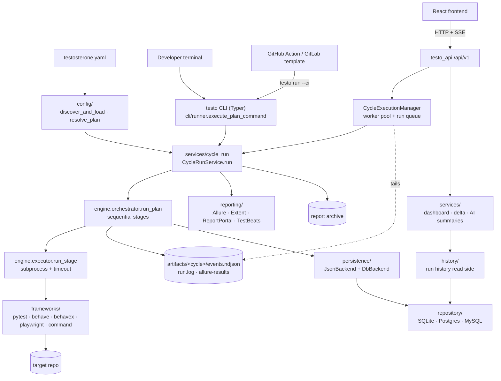

# Architecture Overview

Testo is a **config-driven test orchestration CLI** built around a small, sequential **engine** and **framework adapters**. Heavy dependencies (database, API) are optional extras; every run executes frameworks as **host subprocesses**, whether it starts from the CLI, the API or a CI wrapper.

See also: [Index](../Index.md), [Command Reference](../CLI%20Commands/Command%20Reference.md), [QA Strategies](../Testing%20Workflows/QA%20Strategies.md).

## High-level shape

The picture with a part-by-part explanation is [System Diagram](System%20Diagram.md). This is the same system at module level:



Every run enters through `CycleRunService`; every read of run history goes through `testo_core/history/`; only `testo_core/repository/` opens a database session.

## Core modules

### `testo_core/cli/`

| Module | Role |
|--------|------|
| `app.py` | Typer entry (`testo`); lazy command registration |
| `runner.py` | Bridges CLI → config → engine → reporters → archive |
| `commands/*` | One module per subcommand (`run`, `report`, `config`, …) |
| `ui/` | Rich panels, CI NDJSON renderer, summary dashboards |

The CLI deliberately **defers imports** until a command runs so `testo --help` stays fast.

### `testo_core/config/`

- **`loader.py`** — discovers `testosterone.yaml` (or `--config` path), reads it and picks its shape (`cycles:` or legacy `runs:`).
- **`sections.py`** — parses each section (defaults, cycles, stages, triggers, quarantine, reporters) into the models below.
- **`schema.py`** — `TestosteroneConfig`, `Plan` (cycle), `Stage`, `ReporterSpec`, triggers.
- **`resolver.py`** — merges defaults, interpolates `${env:…}`, resolves stages per cycle.

Cycles are defined under `cycles:` in YAML (legacy key `plans:` is still accepted in some loaders).

### `testo_core/engine/`

| Module | Role |
|--------|------|
| `orchestrator.py` | `run_plan()` — iterates stages, emits events, writes `events.ndjson` |
| `executor.py` | `run_stage()` — spawns subprocess, timeouts, `run.log` tee |
| `exit_codes.py` | `EngineExitCode` taxonomy (0–4) — the single exit-code contract for every surface |
| `result.py` | `StageResult`, `PlanResult` aggregates |

`testo_core/persistence/` provides the `PersistenceBackend` protocol used by the orchestrator (JSON + DB backends, composite fanout). See **Persistence** below.

Execution is **sequential by design**; parallelization today is framework-internal through a stage's `workers` (BehaveX and Playwright always, pytest when pytest-xdist is installed, native behave never; see [Deep Dive - Execution Logic § Framework level](Deep%20Dive%20-%20Execution%20Logic.md#framework-level--optional)).

### `testo_core/frameworks/`

Each **equipment** name maps to an adapter implementing `FrameworkAdapter`:

- `pytest` → `PytestAdapter`
- `behave` → `BehaveAdapter`
- `behavex` → `BehaveXAdapter`: `behavex -o <stage>/behave_reports <args>` with `--parallel-processes N --parallel-scheme feature`. BehaveX's `report.html` is the native report; the executor turns its `report.json` into Allure results after the stage ([BehaveX Reports - 2026-10-21](../Specs%20&%20ADRs/BehaveX%20Reports%20-%202026-10-21.md)).
- `playwright` → `PlaywrightAdapter`: `npx playwright test <args>` in the target repo, which must have `@playwright/test` installed. Adds `--reporter=list,json,html` and `--workers=N` unless `args` set them; the JSON report (`test-results/testo-results.json`, or `test-results/testo-junit.xml` when a stage picks its own `--reporter=junit`) is imported like a `command` stage's `junit_xml`, with retries, flaky tests and attachments ([Playwright JSON Import](../Specs%20&%20ADRs/Playwright%20JSON%20Import%20-%202026-10-22.md)), and Playwright's HTML report is kept as the run's native report. Default tier `e2e`.
- `jest` → `JestAdapter`, `vitest` → `VitestAdapter` (`testo_core/frameworks/jest_adapter.py`): `npx jest <args>` / `npx vitest run <args>`, adding the runner's own JSON report (`test-results/testo-jest.json` / `testo-vitest.json`, no extra package) and `--maxWorkers=N` unless `args` set them. The report is imported with `describe` blocks and retried tests ([Runner Coverage](../Specs%20&%20ADRs/Runner%20Coverage%20-%202026-10-26.md)). Default tier `unit`.
- `cypress` → `CypressAdapter`: `npx cypress run <args>` with Cypress's built-in `junit` reporter (`test-results/testo-cypress-*.xml`) unless `args` set `--reporter`. Default tier `e2e`.
- `command` → `CommandAdapter`: any other runner (Maestro, `go test`, `dotnet test`, ...). `args` is the whole argv. The stage's `junit_xml` globs are converted into Allure results after it exits (`testo_core/reporting/junit_import.py`, which also reads Jest/Vitest, Playwright, RSpec, k6 and `xcresulttool` JSON, TRX, `go test -json`, Robot `output.xml` and Allure results, recognised by content: [Runner Coverage](../Specs%20&%20ADRs/Runner%20Coverage%20-%202026-10-26.md)), so the stage counts in summaries, health % and every reporter. See [Command Adapter and JUnit Import - 2026-09-25](../Specs%20&%20ADRs/Command%20Adapter%20and%20JUnit%20Import%20-%202026-09-25.md).

- `junit` → `JunitAdapter`: runs nothing (`runs_process = False`). The executor records the stage's `junit_xml` reports, whatever their age, and the returncode comes from the results. Used by `testo ingest`, `pytest --testo` (`testo_core/pytest_plugin.py`, which calls the same ingest function) and `POST /api/v1/ingest`; see [Ingest and Team Server - 2026-10-22](../Specs%20&%20ADRs/Ingest%20and%20Team%20Server%20-%202026-10-22.md).

Adapters build `argv`, set Allure output under `allure-results/<framework>/`, and run in `stage.target_repo` as cwd.

Any other name is looked up in installed `testo.frameworks` entry points (`testo_core/plugins.py`); built-in names always win. See [Command Reference § Plugins](../CLI%20Commands/Command%20Reference.md#plugins).

### `testo_core/reporting/`

- **`collector.py`** — walks `artifacts/<cycle>/` for Allure result trees.
- **`entry.py`** — `testo report` dispatch (generate, serve, json/junit export).
- **`reporters/`** — plug-in reporters: `allure`, `extent`, `reportportal`, `testbeats`, plus installed `testo.reporters` entry points (`testo_core/plugins.py`).

Post-run reporters are invoked from `CycleRunService` (`services/cycle_run.py`) after `run_plan()`, for both `testo run` and API cycle executions, when `reporters:` is set in YAML or `--reporter` is passed.

### `testo_core/config/triggers.py`

Optional per-cycle **selective execution**: Git diff or filesystem snapshot against glob patterns. Skipped cycles exit `0` without running stages (unless `--force`). Documented in [QA Strategies § Selective triggers](../Testing%20Workflows/QA%20Strategies.md#2-selective-triggers).

### Adjacent packages (same repo)

| Package | Purpose |
|---------|---------|
| `testo_api/` | FastAPI `/api/v1` — cycle discovery (`GET /cycles`, `GET /cycles/{cycle}`: the config's cycles, `source: config`, then cycles that only have recorded runs, `source: history`, read-only; with no config file only the recorded ones), cycle and ad-hoc executions with SSE, JUnit uploads (`POST /ingest`), runs, analytics, AI summaries, health probes. It also serves the built UI at `/`: the one bundled in the wheel (`testo ui`), or `TESTO_UI_DIR` ([Team Server](../Processes%20&%20Guides/Team%20Server.md)) |
| `frontend/` | React UI — cycles-first navigation plus Quick Run, see [Phase 5 UI Redesign - Cycles-First Navigation](../Specs%20&%20ADRs/Phase%205%20UI%20Redesign%20-%20Cycles-First%20Navigation.md) |
| `testo_core/services/` | `cycle_run.py` (the run use case shared by CLI and API), dashboard, delta, AI failure analysis, report archive diff |

Until v1.1 a second, Docker-based execution stack (`HeadlessEngineService` → `runners.py`) and a Streamlit UI shipped beside these; see [Deep Dive - Execution Logic § Removed: the UQO headless / Docker path](Deep%20Dive%20-%20Execution%20Logic.md#removed-the-uqo-headless--docker-path).

**`testo run`** does not require Docker. `docker-compose.yml` only provides Postgres for local development. For a shared history, `deploy/server/docker-compose.yml` runs the [Team Server](../Processes%20&%20Guides/Team%20Server.md) (API + UI image and Postgres) that CI jobs upload to with `testo ingest --server`.

### Official documentation

| Technology | Reference |
|------------|-----------|
| Allure Report | https://docs.qameta.io/allure/ |
| ReportPortal | https://reportportal.io/docs/ |
| Docker Engine | https://docs.docker.com/engine/ |
| Docker Compose | https://docs.docker.com/compose/ |
| Compose file spec | https://docs.docker.com/compose/compose-file/ |

## Execution logic (happy path)

1. User runs [Command Reference § testo run](../CLI%20Commands/Command%20Reference.md#testo-run) with `--cycle <name>`.
2. `discover_and_load()` loads `testosterone.yaml`.
3. `resolve_plan()` / `resolve_stages_for_plan()` build the effective stage list.
4. If the cycle has a `trigger:` block and not `--force`, `evaluate_cycle_trigger()` may skip the run.
5. Renderer is chosen: Rich buffered (`default`), live stream (`--stream`), or NDJSON (`--ci`).
6. `run_plan()` runs each stage via `run_stage()` (subprocess + timeout from `defaults.timeout_s` or per-stage override).
7. Events land in `artifacts/<cycle>/events.ndjson`; per-stage logs in `artifacts/<cycle>/<stage>/run.log`.
8. Configured **reporters** run (`run_configured_reporters`).
9. **Report archive** writes zip + metrics to the SQL DB (SQLite by default; `testo-core[db]` adds the Postgres driver).

## Artifact layout

```text
artifacts/
  <cycle>/
    events.ndjson
    plan_result.json
    <stage>/
      run.log
      allure-results/
        pytest/ | behave/ | behavex/
          *-result.json
```

The collector and `testo report` both assume this layout. See `testo_core/reporting/collector.py`.

`artifacts/` and the SQLite file are relative to the working directory. Per-run report copies (`static/history/<run_id>/`, served by the API at `/history`) live under the **data root**, `paths.ORCHESTRATOR_ROOT`, which `testo_core/paths.py` resolves once at import:

1. `$TESTO_HOME`, when set.
2. The repository root, when `testo_core` runs from a source checkout or an editable install (a `pyproject.toml` next to the package).
3. Otherwise `<cwd>/.testo/`, so a `pip install` never writes into `site-packages`. The `package` CI job (`scripts/package_smoke.sh`) checks this.

## Test pyramid

Each `Stage` carries a `tier: unit | integration | e2e` (`testo_core/config/schema.py`), explicit in `testosterone.yaml` or inferred from `equipment` (pytest→unit, behave→integration, behavex→e2e). `testo_core/reporting/pyramid_data.py::build_pyramid_model` sums each stage's `total_tests` (from the run's existing `stage_health`, computed by `testo_core/persistence/health.py::compute_stage_health`) into its tier bucket, producing a `PyramidModel(unit, integration, e2e)`. The tier is recorded on each stage row of the run record when the run executes (`StageResult.tier`, persisted by the JSON and DB backends), so renaming or re-tiering a stage later doesn't re-bucket old runs. Only records written before tiers were persisted fall back to the current `testosterone.yaml`.

`testo_core/reporting/pyramid_viz.py` classifies the shape (`HEALTHY`, `TOP_HEAVY`, `MID_BULGE`, `IRREGULAR`) and renders it as ASCII. Reached via `testo report pyramid RUN_ID` ([Command Reference § testo report](../CLI%20Commands/Command%20Reference.md#testo-report)) and, from the API/UI side, `GET /api/v1/runs/{id}/pyramid` feeding a Run Detail visualization — see the "CLI-UI Parity" note under Specs & ADRs for why this existed as dead code before 2026-07-23.

## Exit code contract

Propagated unchanged for CI consumers (`EngineExitCode`):

| Code | Meaning |
|------|---------|
| `0` | Success (including trigger-skipped cycle) |
| `1` | Domain/test failure (non-zero stage return code) |
| `2` | Invalid config or CLI input |
| `3` | Infrastructure failure (timeout 124, missing exe 127, DB/Docker errors) |
| `4` | Internal/unexpected engine error |

Details and examples: [Command Reference § Exit codes](../CLI%20Commands/Command%20Reference.md#exit-codes).

## Configuration as the single source of truth

`testosterone.yaml` drives cycles, defaults (`artifacts_root`, `timeout_s` above 0 or `null` for no limit, `workers` 1 or more; anything else is a config error, as in the JSON Schema), optional `database.url`, optional `history.retention` (`days`, `runs_per_cycle`: when stored runs expire; see [`testo clean --history`](../CLI%20Commands/Command%20Reference.md#testo-clean---history)), `reporters:`, and per-cycle `tags`, `trigger`, and `stages`. `testo init` writes one from the test runners it detects (plus the CI workflow); `testo init --interactive` is the question-by-question wizard and `testo config init` a fixed starter file.

### Persistence

Two persistence layers exist, each at a different abstraction level:

**Engine-level** (`testo_core/persistence/`): Called by `orchestrator.run_plan()` after a cycle completes. Uses a `PersistenceBackend` protocol with two built-in backends:

- `JsonBackend` — writes `plan_result.json` to the artifacts tree (always active).
- `DbBackend` — upserts a `RunRecord` via the repository layer (SQLite by default, so always available), including failure evidence for failed runs (`persistence/failure_context.py`) and CI provenance when run in CI.

Both backends store the resolved `target_repo` from `PlanResult` when attempted stages have one authoritative repository path; runs with different resolved targets or none store `null`.

A `composite_backend()` factory fans out to both; individual backend failures never fail the run. Controlled by `--no-persist`.

**Service-level** (`testo_core/repository/`): Dialect-agnostic adapters selected by `DATABASE_URL` / `database.url` (SQLite default, PostgreSQL/MySQL for teams with existing infra). Used by `DbBackend`, the history read side (`testo_core/history/`), and the report archive system. The run repository is the only code that reads or writes run rows; the accounts, triage, run-queue and resource-lease stores open sessions of their own on the same engine for their own tables. The schema itself belongs to the Alembic revisions in `testo_core/repository/migrations/`: every store calls `create_db_and_tables()`, which upgrades the database to the newest revision (and adopts a database from before migrations existed), so no code creates tables directly. Rationale: [Repository Pattern - Database-Agnostic Refactor](../Specs%20&%20ADRs/Repository%20Pattern%20-%20Database-Agnostic%20Refactor.md). Factory: `testo_core/repository/db.py` → `get_repository()`.

**Two separate, unlinked id spaces** — easy to conflate, worth calling out explicitly (found while building per-test diff for the API, see [CLI-UI Parity - Pyramid, Graphs, Deep Diff - 2026-07-23](../Archive/CLI-UI%20Parity%20-%20Pyramid,%20Graphs,%20Deep%20Diff%20-%202026-07-23.md)):

- **Run-history runs** (`RunRecord` / `CompletedRunView`, `testo_core/history/`): one row per `testo run --cycle` execution, keyed by `run_id`. This is what the dashboard, history, run detail, and delta/compare pages all use (`/api/v1/runs/{run_id}`, `/api/v1/runs/{run_id}/failures` with each failure's marked cause from `services/triage.py` (table `failure_triage`, written through `/api/v1/triage`), the quarantine list from `services/quarantine_store.py` (table `quarantined_test`, through `/api/v1/quarantine`, added to a cycle's `quarantine:` rules by `CycleRunService`), `/api/v1/dashboard/attention` from `services/attention.py`, the README badge `/api/v1/badge.svg` / `badge.json` from `services/badge.py`, `/api/v1/project-health` from `services/project_health.py` with the optional AI review in `services/project_review.py` and questions about the tests (`/api/v1/ask`) in `services/ask_tests.py`, `/api/v1/analytics/delta`, and per test `/api/v1/analytics/tests` and `/api/v1/analytics/test-history`, from `services/test_history.py`, with the last failure's attachments from `services/test_attachments.py`). Carries `stage_health`, `snapshot_dir` (the run's own raw artifact tree). Since revision `0002` the fields lists filter on (`cycle`, `health_pct`, `exit_code`, `branch`, `commit_sha`, `source`, `snapshot_dir`) are indexed columns next to the JSON; one cycle's runs are a SQL query (`history.read_model.list_cycle_runs`), not a scan. For engine runs that is a per-run copy at `static/history/<run_id>/artifacts/`, made by `persistence/db_backend.py` after the run, because the next run of the same cycle overwrites `artifacts/<cycle>/`.
- **Report archives** (`ReportArchive`, `testo_core/repository/report_archive_repository.py`): one row per `testo report list/open/diff` archive, a zipped Allure snapshot keyed by its own UUID (`report_id`), with **no `run_id` column linking it back** to the run that produced it. Populated separately by `CycleRunService` (`testo_core/services/cycle_run.py`) after each run, via `try_persist_cycle_report()`.

Retention (`testo_core/history/retention.py`): when `history.retention` is set, expired runs lose their `runrecord` row, `test_result` rows and `static/history/<run_id>/` folder together, from `testo clean --history` or the API's timer; nothing is deleted otherwise.

Code that needs per-test outcomes for a *run_id* (not a *report_id*) calls `history.cases.cases_for_run(run)`: since revision `0003` each run's tests are rows of the `test_result` table (`repository/test_results.py`), written by `persistence/db_backend.py` after the run and, for runs recorded earlier, filled once from the run's snapshot on first read. Attachments and traces still come from `CompletedRunView.snapshot_dir` (via `history.snapshots.snapshot_files_for_download()`). Neither resolves a `ReportArchive` row — there isn't one to resolve to. See `testo_core/services/run_snapshot_diff.py` for the file-based pattern.

Resource pool leases (`testo_core/resources/store.py`, tables `resource_item`, `resource_lease`, `resource_waiter`, plus `resource_action`, the log of provider commands people ran with `testo pool`) live in the same database and are unrelated to runs: they say which parallel worker holds which key right now. See [Shared Resource Pools](../Processes%20&%20Guides/Shared%20Resource%20Pools.md).

## Related operational docs

- CI: [CI-CD Pipeline Setup](../Processes%20&%20Guides/CI-CD%20Pipeline%20Setup.md), [QA Strategies § CI and streaming output](../Testing%20Workflows/QA%20Strategies.md#ci-and-streaming-output)
- Pages demo: [GitLab Pages Demo](../Processes%20&%20Guides/GitLab%20Pages%20Demo.md)
- Current state and next steps: [Product Roadmap](../Roadmap%20&%20Strategy/Product%20Roadmap.md)
