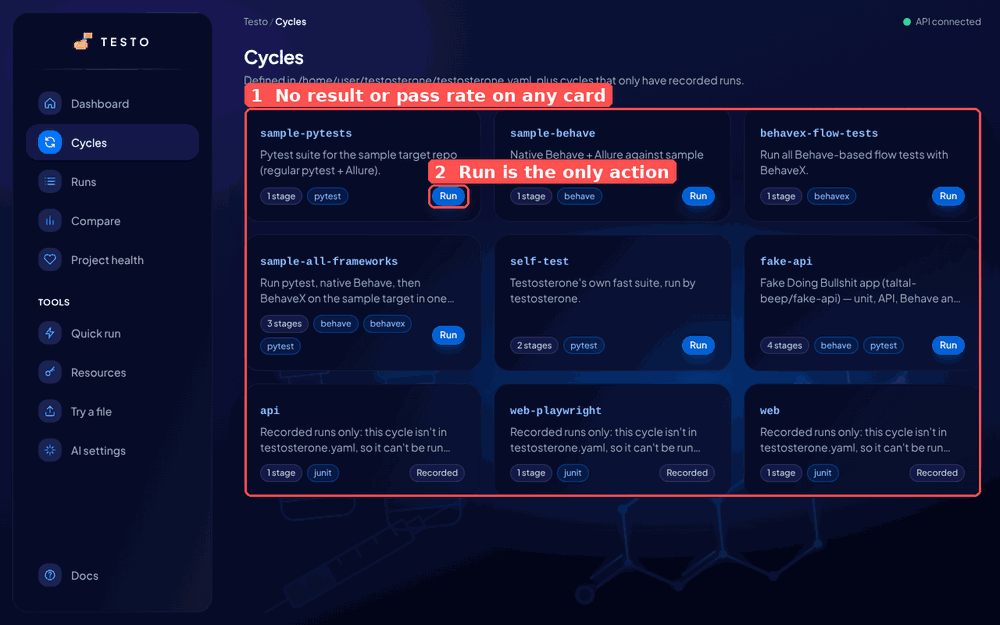
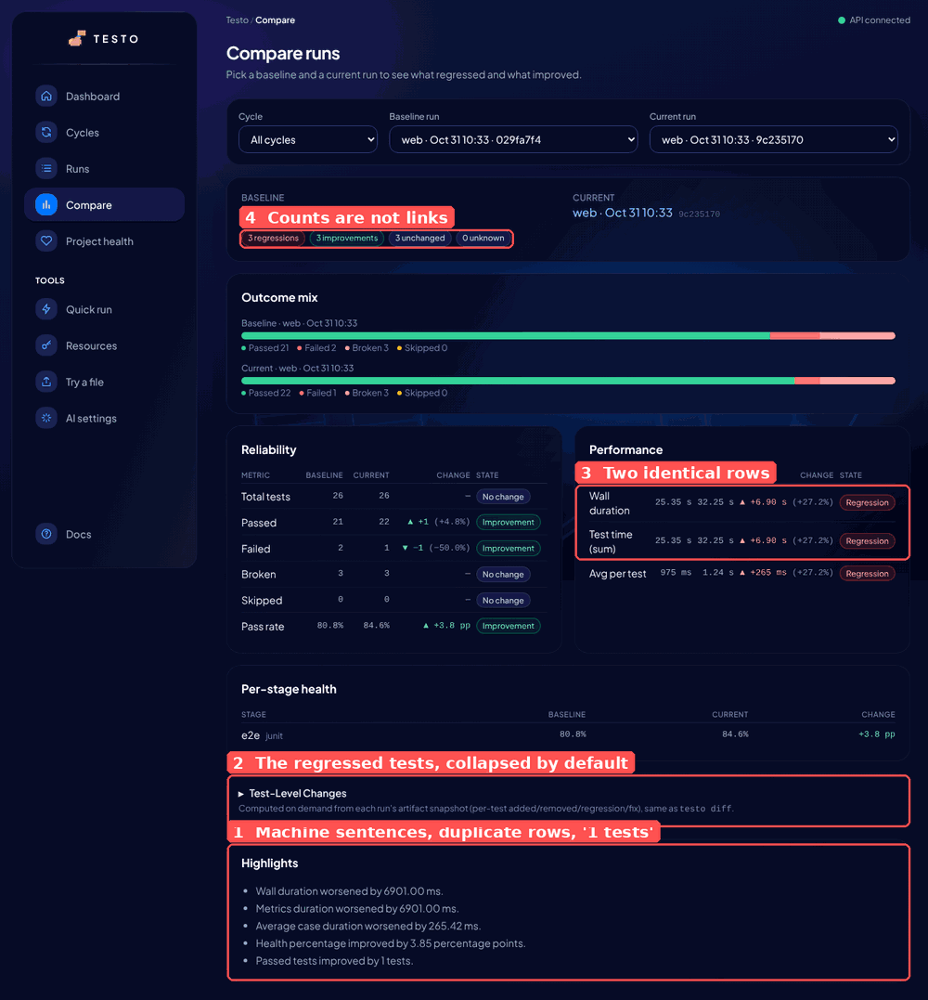
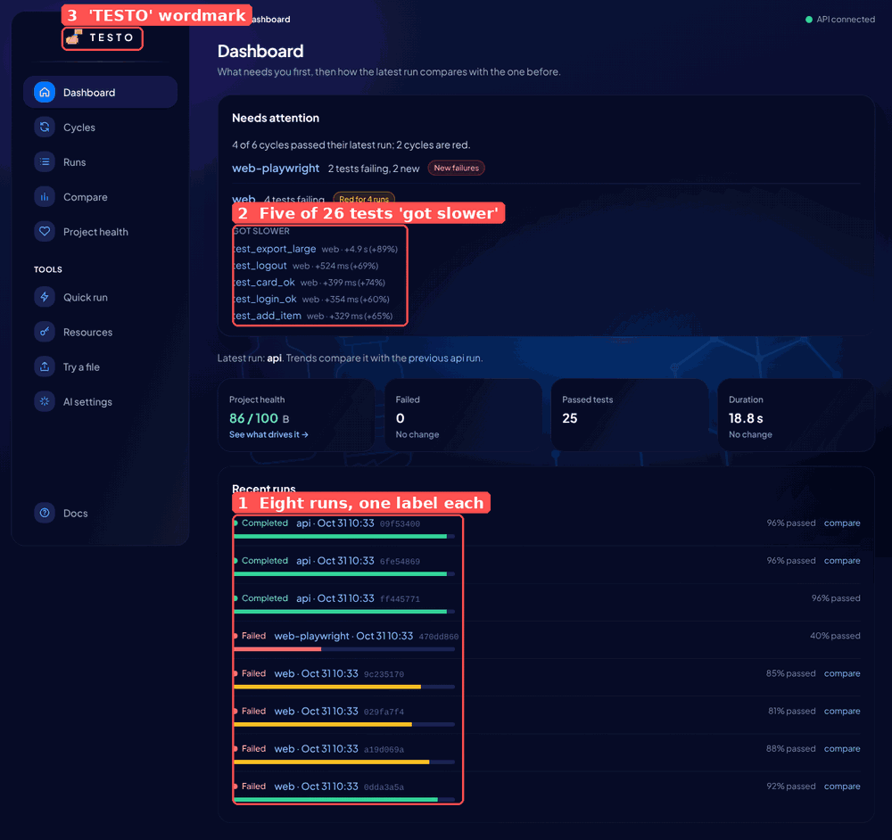
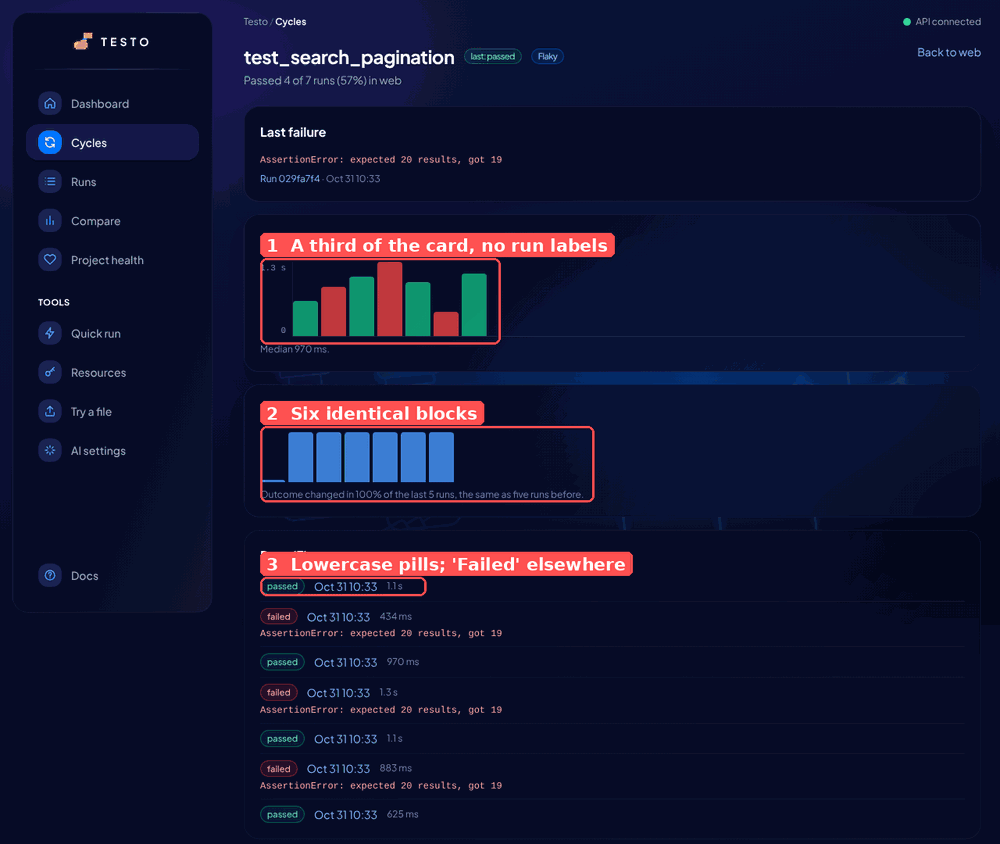
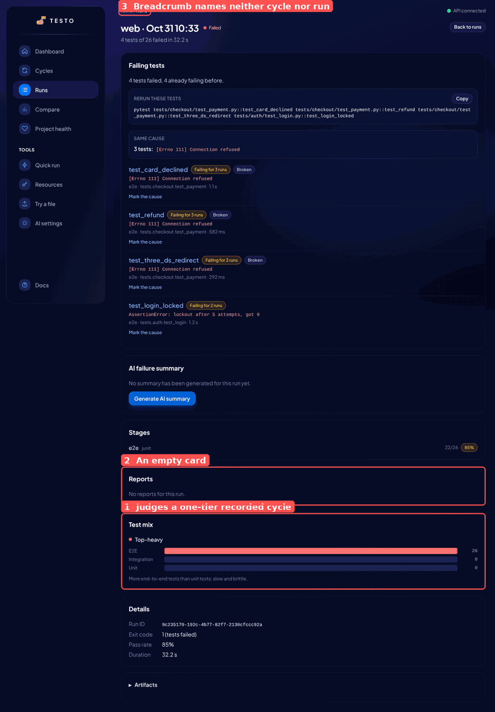
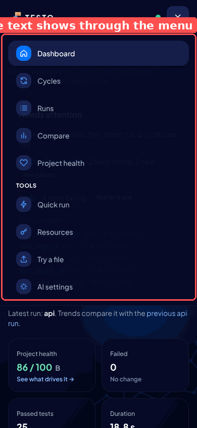
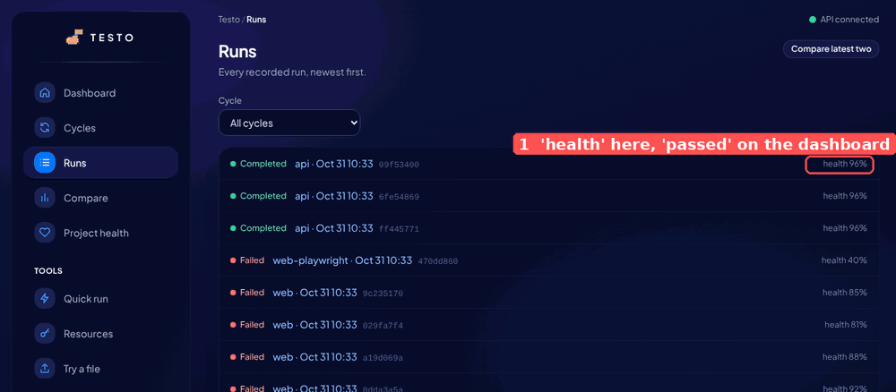

# UI Design Review - 2026-10-31

[Index](../Index.md) · companion to the [Product Review](../product-review.md), which scored the UI as part of the product. This note looks only at the web UI as a piece of design: hierarchy, consistency, copy, density, charts, empty and error states, accessibility, and whether it looks like a product a team would pay for.

## Context

Taltal asked for a design and UX review of the web UI, done with Claude Fable 5.1. A separate thread hunts functional bugs, so this note skips anything that is simply broken and stays on how the UI reads and feels.

How it was checked, `main` at `2c6048a` (2026-10-31):

- The UI built from `frontend/` against a local API, with 18 runs in 6 cycles: three config cycles run for real (`sample-pytests`, `sample-behave`, `sample-all-frameworks`), seven ingested JUnit runs of a `web` cycle with a flaky test, three failures that share a `ConnectionRefusedError`, a test that gets slower every run and a test that starts failing late, a Playwright JSON import, and three green `api` runs.
- Every page at 1280 px and 390 px, plus 640 × 450 for 200 % zoom, the phone menu open, the try-it sample, the Compare test-level section expanded, the triage form open, the artifacts list open, keyboard focus and hover. The UI has one theme (dark), so there is no light pass.
- `axe-core` 4.10 (WCAG 2 A/AA plus best practice) on every page.
- Compared, in the reviewer's head, with the dashboards teams already look at every day: GitHub Actions, Vercel, Linear, Grafana, Allure, Currents.

Annotated screenshots are in `assets/ui-review-2026-10-31/`; the full set (34 shots) is in the project files folder.

## Verdict

**7.5 / 10 as a design.** The product review gave visual design 9 against "does the page answer the user's question"; this note asks "would a designer sign it off", and the answer is: nearly. The bones are right. One accent colour, one card surface, one type family, sentence-case copy nearly everywhere, a sidebar that stays out of the way, phone layouts that never overflow, and `axe` finds nothing on 16 of 17 pages. The run page is the best screen in the product: the failing tests, the rerun command and the shared cause come first and nothing competes with them.

What holds it at 7.5 is that several pages still put the computed thing above the thing the user came for, and a handful of details read as unfinished: the Cycles grid shows no result at all, Compare hides the regressed tests under four tables of totals and ends with sentences a script wrote, the test page's two charts are a stub and a row of identical blocks, and every run on every list carries the same label. None of this is a redesign. Most of it is a day each.

## Scorecard

| Area | Score | In one line |
|------|:-----:|-------------|
| Visual hierarchy | 8 | Dashboard and run page lead with the right thing. Cycles, Compare and the test page don't (U1, U2, U6) |
| Consistency | 7 | One surface, one accent, one font. But `Completed` next to `passed`, `Test-Level Changes` next to sentence case, `Status_change` as a filter, `health` on one list and `passed` on the next (U5, U10, U12) |
| Copy | 7.5 | Plain sentences on most pages; Compare and dashboard highlights are machine output (U3), Test mix lectures a one-tier cycle (U8) |
| Information density | 8 | Cards are well filled on a laptop and a phone. Empty cards ("Reports", "Stages (1)") and a raw artifact list are the exceptions (U8, U11) |
| Charts | 6 | The stacked bars and the health ring are good. The test page's duration and flakiness charts are not finished (U6), and "got slower" lists need a cap (U7) |
| Empty and error states | 8.5 | Mascot empty states with the exact command to run; the try-it page is a model. The 404 lacks a page heading (U13) |
| Accessibility | 9 | `axe` clean except the 404 heading, visible focus ring, no overflow at 390 px or 200 % zoom. Not checked: a screen reader |
| Looks like a product | 7.5 | The glass-on-navy look is distinctive and well executed. Dark only, a joke wordmark, and syringes behind the Quick run form are choices to make on purpose (U14) |

## Findings, ranked

Severity is how much the item costs a user who looks at the page every day, not how hard it is to fix. "Fix" says what to do; "Where" is the file to start in.

### U1 High: the Cycles grid shows no result

Nine cards, and a cycle that has been red for four runs looks exactly like one that is green. The only data on a card is the stage count and the equipment, which never change. The one coloured element is the `Run` button, so the page reads as a launcher, while most of the time the user comes here to ask "which of these is red?".

**Fix:** each card gets the last run's status pill, the pass-rate strip the dashboard already draws, and when it ran ("12 min ago"). `Run` becomes a secondary button. The data exists: `GET /api/v1/dashboard/attention` and `latest_run_per_cycle` already compute it for the dashboard.
**Where:** `frontend/src/features/cycles/CyclesPage.tsx`, `GET /api/v1/cycles` (add `latest_run` per item).

### U2 High: Compare hides the regressed tests

The question Compare answers is "which tests regressed?". The page shows the count (`3 regressions`) at the top as a pill that goes nowhere, then Outcome mix, Reliability, Performance and Per-stage health, all totals, and only then `Test-Level Changes`, collapsed, with a caption about artifact snapshots. The user has to scroll past four cards and click to see the three test names. On a phone that is two screens.

**Fix:** move the test-level list directly under the summary and open it by default when there is at least one regression or fix; make the four count pills scroll to it with the matching filter on. Rename the section "What changed per test" (sentence case, like every other card) and the filter chips `Regression · Fix · Added · Removed · Status change`. Drop `Test time (sum)` when it equals `Wall duration`, which is every ingested run.
**Where:** `frontend/src/features/compare/ComparePage.tsx` (`CASE_KIND_LABELS`, the disclosure around line 480).

### U3 High: highlights are sentences a script wrote

The `Highlights` card on Compare and the top highlights on the dashboard read:

> Wall duration worsened by 6901.00 ms.
> Metrics duration worsened by 6901.00 ms.
> Average case duration worsened by 265.42 ms.
> Health percentage improved by 3.85 percentage points.
> Passed tests improved by 1 tests.

Five lines, two of them the same number under two names, milliseconds with two decimals, "1 tests", and "health percentage" on a product that now calls this pass rate. This is the one card that is meant to be read aloud in a standup, and it is the least readable thing on the page.

**Fix:** format in `delta_service._build_highlights`: durations through the same rule the UI uses (`6.9 s`, `265 ms`), counts with the right plural ("1 more test passed", "5 more tests failed"), pass rate as "Pass rate up 3.8 points", and skip `Metrics duration` when its delta equals the wall-duration delta. Five lines becomes three.
**Where:** `testo_core/services/delta_service.py` lines 273 to 294, with the contract tests that pin the strings. Fixed in the polish pull request that accompanies this note.

### U4 Medium: every run has the same label

Runs are labelled `cycle · Oct 31 10:33`, to the minute, with the short id in monospace as the only thing that tells two runs apart. Eight runs on the dashboard carry four distinct labels. Runs in CI land minutes apart, so this is the normal case, not a test artifact. The id is the least human thing on the row and it is doing all the work.

**Fix:** show relative time ("4 min ago", with the full timestamp as a tooltip) and the branch and short commit when the run has them (`git_branch`, `git_commit` already exist on local and CI runs). Add seconds only when two visible runs share a minute. The short id stays, dimmer, for copy-paste.
**Where:** `frontend/src/components/ui/RunLabel.tsx`, `frontend/src/lib/format.ts`.

### U5 Medium: the breadcrumb never names the thing

The breadcrumb is always `Testo / Section`: on the `web` cycle page it says `Testo / Cycles`, on a run `Testo / Runs`, on a test `Testo / Cycles`. The back link on a run says `Back to runs`, so a user who arrived from a cycle page loses the cycle. And `Testo` is not the product's name: the name decision of 2026-10-26 kept "Testosterone", and the README, PyPI and docs say so.

**Fix:** `Cycles / web`, `Cycles / web / test_search_pagination`, `Runs / web · Oct 31 10:33`, each segment a link. The cycle and test names are in the URL, so the shell can do this without loading data; the run label needs the run, so the run page passes it up or the crumb shows the short id. Fixed for the path-based cases in the polish pull request.
**Where:** `frontend/src/app/AppShell.tsx` (`sectionLabel`).

### U6 Medium: the test page's charts are not finished

- `Duration` draws seven bars in the left third of the card, with a y-axis of two ticks, no x labels and no link from a bar to its run. The caption `Median 970 ms` is the only readable number.
- `Flakiness over time` is six identical blue blocks after a short stub. There is no axis, no value, no colour change; the sentence under it says 100 % and the blocks say nothing. A reader cannot tell if this is a chart or a loading skeleton.
- The `Runs (7)` list uses lowercase `passed` / `failed` pills, while every other list says `Completed` / `Failed` through `StatusPill`. The list also carries no run id and no link, so the `Last failure` card's `Run 029fa7f4` link cannot be matched to a row.

**Fix:** let the bars fill the card width with the run date under every second bar and a click to the run; for flakiness, a single line of flip rate over the window (0 to 100 %) with the two reference points labelled, or drop the chart and keep the sentence; one `StatusPill` for test outcomes too (`Passed` / `Failed` / `Broken` / `Skipped`), and each run row a link.
**Where:** `frontend/src/features/tests/TestPage.tsx`, `frontend/src/components/ui/StatusPill.tsx`.

### U7 Medium: "got slower" lists fill with noise

With durations jittered uniformly between 50 ms and 1.5 s, 15 of the 26 `web` tests were flagged as slower (`+60 %` to `+89 %`), the dashboard and the cycle page each list five, and Project health docks 18 points of Speed trend. The one test that really gets slower every run (`test_export_large`, +4.9 s) is first, which is right, but it is followed by four tests whose change is within their own spread. Design-wise the lists have no cap, no "and 10 more", and no hint of the spread the number is measured against.

The jitter in this data is wider than most suites show, so the threshold may be fine on real runs. This is handed to the bug thread to check against `fake-api` history; the design fix stands either way.

**Fix:** cap the list at three with "and N more" linking to the cycle page's `Got slower` section; show the test's median next to the delta ("+524 ms on 760 ms"), so a reader can judge it; sort by absolute delta, not percent, so a 300 ms change on a 400 ms test does not outrank a 2 s change on a 10 s test.
**Where:** `frontend/src/features/dashboard/NeedsAttention.tsx`, `frontend/src/features/cycles/CycleTestsCard.tsx`, `testo_core/services/test_history.py` (noise floor).

### U8 Medium: cards that judge, and cards that are empty

- `Test mix` on a run page says `Top-heavy` in red and "More end-to-end tests than unit tests: slow and brittle" for a cycle that was ingested with a single `--tier e2e` stage. Every ingested run has one tier, because `testo ingest` takes one `--tier`, so the card scolds the most common kind of run for a shape it cannot have chosen.
- `Reports` shows a card whose whole content is "No reports for this run." Same for `Stages (1)` on a recorded cycle's page, which repeats the one stage name the header already implies.

**Fix:** hide Test mix when the run has one tier, or make it informational (no colour, no verdict) and keep the verdict for runs with two or more tiers; fold "No reports" into the `Details` key-value list as a row, and drop the `Stages` card on history-only cycles.
**Where:** `frontend/src/features/run-detail/RunDetailPage.tsx`, `frontend/src/components/ui/TestPyramid.tsx`, `frontend/src/features/cycles/CycleDetailPage.tsx`.

### U9 Low: the phone menu lets the page show through

The disclosure menu is 95 % navy with a backdrop blur. In Chromium headless the blur does not render and the dashboard's headings show through the menu; on a phone that can't do `backdrop-filter` it is the same. Fixed in the polish pull request by making the panel opaque.

### U10 Low: `health 96 %` on Runs, `96 % passed` on the dashboard

Since #191 "health" is the project score and the per-run figure is the pass rate, which the dashboard and the run page already say. The Runs list still prints `health 96%`. Fixed in the polish pull request.

### U11 Low: the Artifacts disclosure is a raw file list

Opening `Artifacts` on a run prints 29 paths, 26 of them `e2e/allure-results/junit/<uuid>-result.json`. Nobody reads that; the three that matter (`run.log`, `events.ndjson`, `plan_result.json`) are at the bottom. Group by stage, collapse result files to "26 Allure result files", and show logs first.
**Where:** `frontend/src/features/run-detail/RunDetailPage.tsx`.

### U12 Low: small inconsistencies

- `Test-Level Changes` is the only Title Case heading in the UI, and `Status_change` the only snake_case label. Fixed in the polish pull request.
- Tables set numbers in monospace at 12 px next to 14 px sans labels (Compare's Reliability and Performance, Per-stage health). It reads like a terminal dump inside a glass card. Use the body font with `tabular-nums` and keep monospace for ids and commands.
- The `Project health` tile shows `86 / 100 B`, where the grade letter floats as a separate word with no label. "86 / 100 · B" or a small `Grade B` caption.
- `AI settings`: the status line ("Not configured: OPENAI_API_KEY is not set …") sits as plain text under the card, while the same message on Project health is an amber notice. Use the notice.
- `Quick run` and `AI settings` leave two thirds of a laptop screen to the background art. Either widen the form card to the content width, like every other page, or give the empty side something (recent quick runs, a short "what this does").

### U13 Low: the 404 page has no page heading

`axe` reports `page-has-heading-one` on `/nope`: `EmptyState` renders an `h2` and the page has no `h1`. Fixed in the polish pull request.

### U14 Low: the look is a choice; make it on purpose

The navy glass theme is well done and nothing on it is wrong. Three things about it are decisions rather than defects, and they are Taltal's:

- **Dark only.** Most CI dashboards offer both. Teams that run light-mode IDEs will screenshot a black box into a light Slack. Tokens already live in `tailwind.config.ts`, so a light theme is a second palette, not a rewrite. Proposal only.
- **The `TESTO` wordmark.** The sidebar and top bar say `TESTO`; everything else says Testosterone. One name.
- **The syringes.** The background art (vials, a syringe, a steroid molecule) is a good joke at low opacity behind data. On the Quick run, Try and Resources pages, where there is no data, it is the whole screen, and the joke is what a manager sees in a screenshot. Lower its opacity on empty pages, or swap those pages to the molecule only.

## What the polish pull request does

Small, safe, no behaviour change beyond labels: U3 (highlight sentences), U5 (breadcrumb names the cycle and test from the URL, run shows its short id), U9 (opaque phone menu), U10 (`passed` on the Runs list), U12 (sentence case and `Status change`), U13 (404 heading). Everything else above is a proposal and waits for Taltal's pick, in this order of value: U1, U2, U4, U6, U8, U7, U11.

## Consequences

- Scores are relative to the dashboards teams already use, so they are lower than the product review's design line; both are right for their question.
- The findings with `Where` pointers are small enough for a first-time contributor; U1 and U4 are good first issues once Taltal agrees with the direction.
- Not covered: a screen-reader pass (needs a person), the static demo build on GitHub Pages (same components, same findings), and the Allure HTML reports, which are not this UI.
